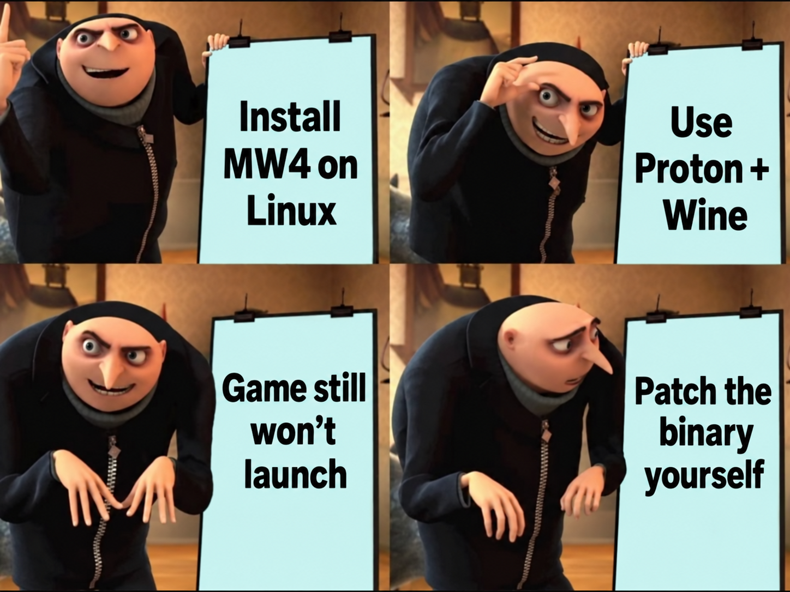

# MW4 Linux Patcher

**Patch a supported Windows MW4 campaign build to run on Linux through Proton.**

Checks your build, backs up affected files, patches startup and launches the game. Includes a restore command.



**Alpha:** reached the campaign menu on Bazzite with an RX 7900 XTX. Nine regression tests, a live tracing test and file restore passed. Full gameplay and controller testing remain open.

## Before you start

- Linux x86-64, Python 3.10+, UMU and GE-Proton11-9.
- The supported offline campaign files, including `sp26/rex_sp.dll`. [Windows download page](https://fitgirl-repacks.site/call-of-duty-modern-warfare-4/).
- The two VKD3D DLLs matching [these hashes](build_profile.py). You must supply them; the patcher does not download dependencies.
- A separate game copy and Wine prefix. Close MW4 before making changes.

Only one exact build is supported. Run `doctor` to check yours. Other builds, untouched retail installations, multiplayer and macOS are unsupported. Testing used an existing working prefix; fresh setup is not yet verified.

## Install

Replace the paths below. `/path/to/game` is the folder containing `sp26/`.

```bash
git clone https://github.com/PotatoSpudowski/mw4-linux.git
cd mw4-linux
python3 mw4.py doctor --game /path/to/game
python3 mw4.py install --game /path/to/game \
  --graphics /path/to/verified-vkd3d-dlls
```

`doctor` reads files only. `install` checks the inputs and saves backups in `.mw4-linux` before changing files.

## Launch

Run from your graphical desktop terminal:

```bash
python3 mw4.py launch --game /path/to/game \
  --umu /path/to/umu-run \
  --proton /path/to/GE-Proton11-9 \
  --prefix /path/to/test-prefix \
  --game-argument 'ARGUMENT_FROM_YOUR_EXISTING_CAMPAIGN_LAUNCHER'
```

Use the argument from your existing offline launcher. Portable setups may also need `--home /path/to/portable-home` to find their UMU runtime.

**Launch through the patcher every time.** The prepared DLL waits for it. For Steam, add a shell wrapper with this full command, rather than the EXE. Logs are in `.mw4-linux/run-TIMESTAMP/`.

## Undo

Close the game, then run:

```bash
python3 mw4.py restore --game /path/to/game
```

Restores the backed-up files. Refuses to overwrite files changed after installation. Keeps the backups and receipt.

## How it works

**Pause startup → repair the device request and checks → detach and continue.**

The patcher pauses the game at a known point, makes ten checked memory edits and redirects the exact Randgrid device request to NUL. It repairs a second startup checkpoint, then detaches. Proton and VKD3D handle the game and graphics afterward.

This changes the startup path; it does not run the Windows driver on Linux. The tracer is experimental, including its handling of multiple threads. Use a test copy.

[Detailed setup](docs/guide.md) · [Technical notes](research/mechanism.md) · [Test results](research/validation.md) · [Tests](tests/)

## Credits

Based on the community `codpatch` repair, implemented here in Python. Uses UMU, Proton and VKD3D. This repo contains patcher source, not game files or dependency binaries.
